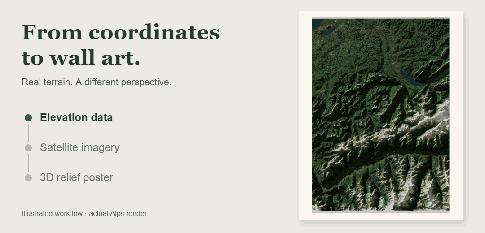

# Hi, I'm Natboa

I build radio apps, terrain posters, and practical developer tools.

Software Engineering student at Braude Academic College. My projects span desktop and mobile apps, graphics, and automation.

## Shaded Relief Maps — Poster Maker

Turn a place into a printable 3D terrain poster. Elevation data and satellite imagery become a lit relief in Blender, with optional roads, place names, trip pins, and routes.

<a href="https://mapyourtrip.vercel.app">
  <picture>
    <source media="(prefers-reduced-motion: reduce)" srcset="assets/terrain-still.jpg">
    
  </picture>
</a>

**Python · Blender · Geospatial data** 
[Try the trip planner and poster maker](https://mapyourtrip.vercel.app)

## RadioV2 — Windows & Android

Discover and stream internet radio across desktop, phone, Android Auto, and Android TV. Browse by genre, save favourites, and keep listening in the background.

<a href="https://github.com/Natboa/RadioV2-Android">
  <picture>
    <source media="(max-width: 600px)" srcset="assets/radio-mobile.jpg">
    
  </picture>
</a>

**Windows: C# · .NET · WPF · EF Core** 
[Download for Windows](https://github.com/Natboa/RadioV2/releases) · [Windows source](https://github.com/Natboa/RadioV2)

See the Windows desktop app

 

**Android: Flutter · Dart · Riverpod** 
[Download for Android / TV](https://github.com/Natboa/RadioV2-Android/releases) · [Android source](https://github.com/Natboa/RadioV2-Android)

## Attend — Meditation Aid

A quiet companion for meditation: flexible session timers, scheduled mindfulness bells, and 289 wisdom poems from five traditions. No account required.

**Flutter · Dart · Riverpod** 
[Download for Android](https://github.com/Natboa/Attend-Meditation-Aid/releases) · [Source](https://github.com/Natboa/Attend-Meditation-Aid)

## More things I've built

- **[Browser Video Recorder](https://github.com/Natboa/browser-video-recorder)** — An agent skill that saves browser-only course videos and lectures as local MP4 files using OBS on Windows.
- **[Linux Shell](https://github.com/Natboa/Linux-Shell)** — A custom shell in C with command history, encryption, and file merging, exploring processes and system calls.

## Tools I build with

**Apps:** Flutter · Dart · C# · .NET · WPF · EF Core 
**Visual tools:** Python · Blender 
**Foundations:** C · Java · Git · Linux · Bash
